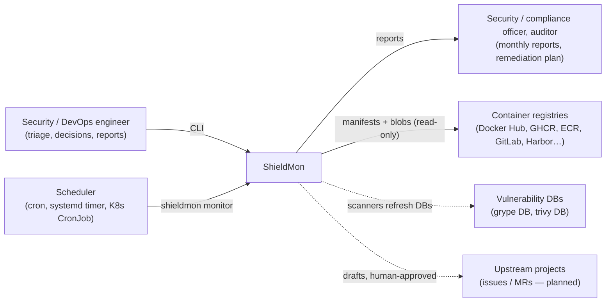
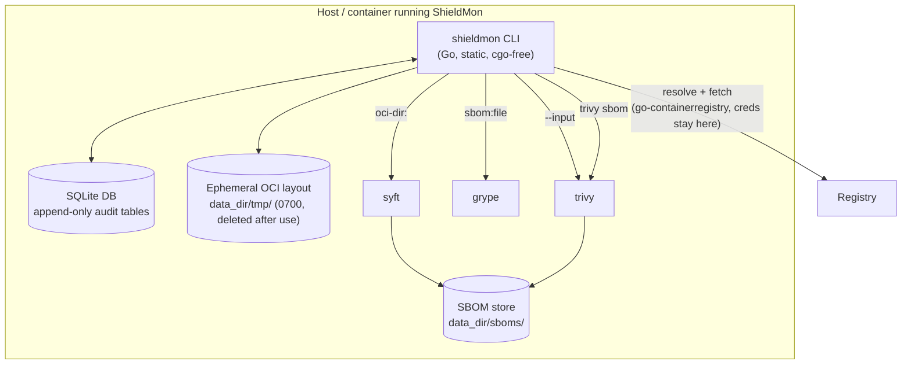

# Architecture

## C4 — System context



## C4 — Containers (single-node deployment, M1)



Scanners are child processes with an allowlisted environment, bounded runtime and
bounded output. They never see registry credentials and never pull images: they read a
local, digest-verified OCI layout (generators) or a stored SBOM (matchers).

## Pipeline

```
scan REF / monitor
  │
  ├─ oci.Resolve(ref, platform) ─────────────► digest  (tag → index → platform manifest)
  ├─ store: upsert target, artifact, record resolution (append target_digests on change)
  ├─ engine.ensureSBOMs(digest)
  │     └─ only if an SBOM is missing for a required generator:
  │          oci.Fetch → limits check → digest-verified OCI layout (tmp)
  │          syft  → CycloneDX + SPDX     (consumed by grype)
  │          trivy → CycloneDX            (consumed by trivy)
  │          validate shape/size → store blob + sha256
  ├─ engine.match(digest)
  │     ├─ grype sbom:<syft.cdx>   ┐  each: tool version + DB version + DB build time
  │     ├─ trivy sbom <trivy.cdx>  ┘  failure → health finding; scan becomes partial
  │     ├─ normalize.Merge         canonical PURL, CVE-preferred IDs, cross-scanner dedupe
  │     └─ store.ReconcileScan     lifecycle.Reconcile (pure) + apply in one transaction
  ├─ engine.trackLineage      manifest + config only: layers and base annotations once per
  │                           digest; base tag resolved once per cycle (ADR 0022); SBOMs of
  │                           the newest base digest once, never matched (ADR 0023)
  └─ health checks: DB age, auth, fetch, generator/matcher, checksum, schedule
```

Re-running `scan` (or `monitor`) on an unchanged tag costs one manifest request plus two
matcher runs: SBOM-first is a property of the pipeline, not a separate mode.

## Packages

| Package | Responsibility | Depends on |
|---|---|---|
| `cmd/shieldmon` | entry point, signals | `cli` |
| `internal/cli` | cobra commands, output formatting | everything below |
| `internal/engine` | orchestration, health findings, data-dir lock | oci, scanner, normalize, store |
| `internal/oci` | ref parsing, digest resolution, bounded fetch to OCI layout; registry providers (credentials, bounded listing) | go-containerregistry, AWS SDK |
| `internal/scanner` | plugin registry, hardened process runner, syft/grype/trivy adapters, parsers | redact |
| `internal/scanner/scannertest` | conformance kit for scanner adapters | scanner, normalize |
| `internal/normalize` | canonical PURL / vuln IDs, alias mapping, merge | packageurl-go |
| `internal/lifecycle` | **pure** state machine + reconciliation planner | model |
| `internal/priority` | **pure** remediation priority score with reasons (ADR 0020) | model |
| `internal/lineage` | **pure** base image status from recorded layers and observations (ADR 0022); remedy per package from SBOM layers and the newest base's SBOM (ADR 0023); configured successors (ADR 0025) | normalize, sbom, config, oci (reference parsing) |
| `internal/export` | exporter registry, Dependency-Track and DefectDojo exporters (reusing the notifiers' hardened HTTP helpers); `exporttest` conformance kit (ADR 0027) | notify, report, normalize |
| `internal/owners` | which team owns a target, from reference patterns in the configuration (ADR 0024) | config, oci |
| `internal/runtimectx` | where images run and whether they are exposed, from read-only `kubectl get -o json` exports; bounded parser of hostile input (ADR 0029) | — |
| `internal/server` | `shieldmon serve`'s HTTP API: read endpoints, triage and decisions authored by the authenticated identity, roles, API tokens (ADR 0031) | store, lifecycle, report, priority |
| `internal/gate` | **pure** policy gate: rules, exemptions by decision, fail-closed verdict, SARIF (ADR 0021) | config, report |
| `internal/vex` | **pure** OpenVEX / CycloneDX VEX parsing (bounded, fuzzed), OpenVEX export, statement matching | normalize, go-containerregistry |
| `internal/enrich` | enricher registry, CISA KEV catalog (bounded, validated, fuzzed, cached outside the scanners' reach); `enrichtest` conformance kit | model, redact |
| `internal/sbom` | **pure** reading of components back from stored CycloneDX SBOMs (bounded, fuzzed) | — |
| `internal/notify` | notifier registry, **pure** event computation from monitoring state, dispatch (digest, bounds), hardened HTTP helpers; `notifytest` conformance kit | redact |
| `internal/store` | SQLite schema, migrations, transactional apply; audit chain sealed in every write transaction and its verification | lifecycle, model |
| `internal/report` | monthly report from the audit trail; format registry (md/json/csv/html/sarif, remediation plan, inventory) | store, config |
| `internal/redact` | credential redaction | — |
| `internal/config` | YAML config, SLA profiles | model |
| `internal/model` | shared domain types | — |

Extension points (scanners, report formats, registry providers, notifiers; later
enrichers, chart sources, remediation advisors) are interfaces with registries — see
[docs/extending](docs/extending/README.md) and ADR 0008.

`lifecycle` has no I/O so that every closure rule is unit-testable; `store` loads its
inputs and applies its plan inside one transaction.

## Data model

```
targets(ref, platform, current_digest)           what we monitor
  └─< target_digests (APPEND-ONLY)               every digest a target pointed to
artifacts(digest PK, repository, platform)       immutable things we scanned
  ├─< sboms(digest, generator, format, sha256)   SBOM blobs on disk
  ├─< scans(kind, status, tools JSON)            each matching run, with DB versions
  │     └─< scan_matches (APPEND-ONLY)           what each scan observed
  └─< findings UNIQUE(digest, purl, vuln_id)      lifecycle state, first_detected (inherited)
        ├─< finding_events (APPEND-ONLY)         every transition: actor, reason, evidence scan
        └─< decisions (APPEND-ONLY)              risk acceptance / not affected (+ expiry)
target_bases (APPEND-ONLY)                       base tag configured per target
image_inspections (APPEND-ONLY)                  layers + base annotations, once per digest
base_observations (APPEND-ONLY)                  every digest a base tag pointed to
health_findings(check, subject)                  self-health
monitor_runs                                     cadence for missed-schedule detection
```

**Lineage.** Findings on successive digests of the same target are linked by
`(pkg_key = PURL without version, vuln_id)`. A successor finding inherits
`first_detected_at` and triage/decision state, so MTTR measures the problem, not the
image rebuild.

## Deployment shapes

- **M1 (now):** single binary + scanners on a host or in a container; `shieldmon monitor`
  from cron/systemd/K8s CronJob; SQLite in a persistent volume.
- **Server (M4+):** same binary in `serve` mode, PostgreSQL, worker pool, API, notifications.
